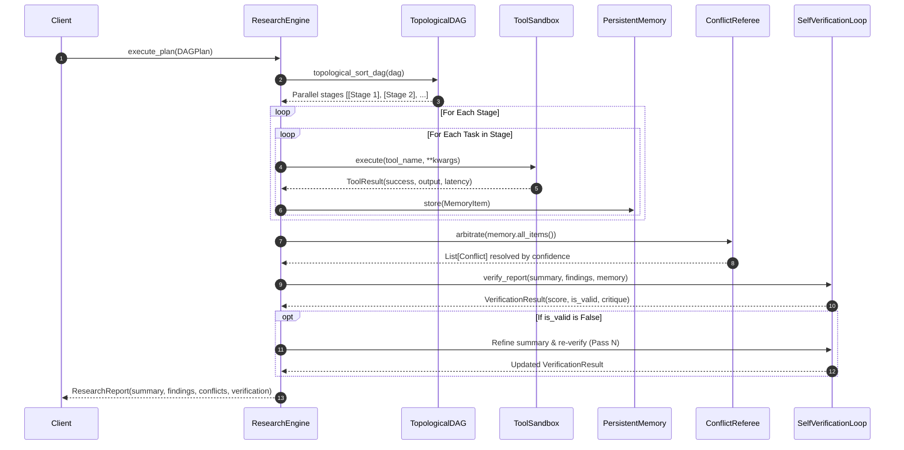

# Autonomous Multi-Agent Research & Reasoning System

[](https://www.python.org/)
[](https://docs.pydantic.dev/)
[](test_engine.py)
[](LICENSE)

An autonomous multi-agent research and reasoning system featuring DAG task decomposition (LangGraph style), a sandboxed tool execution runtime, persistent memory buffer, an arbitration conflict referee, and self-verification refinement loops.

---

## Architecture Overview

```
                               ┌────────────────────────────────┐
                               │     Research Goal / Query      │
                               └───────────────┬────────────────┘
                                               │
                                               ▼
                              ┌──────────────────────────────────┐
                              │     DAG Task Decomposition       │
                              │ (Kahn's Topological Stage Sorter)│
                              └───────┬──────────────────┬───────┘
                                      │                  │
                                      ▼                  ▼
                         ┌───────────────────────┐ ┌───────────────────────┐
                         │ Stage 1: Literature   │ │ Stage 1: Data Mining  │
                         │    (Parallel Task)    │ │    (Parallel Task)    │
                         └───────────┬───────────┘ └───────────┬───────────┘
                                     │                         │
                                     └────────────┬────────────┘
                                                  ▼
                                     ┌─────────────────────────┐
                                     │ Tool Execution Sandbox  │
                                     │ (AST Math, Search Index)│
                                     └────────────┬────────────┘
                                                  │
                                                  ▼
                                     ┌─────────────────────────┐
                                     │ Persistent Memory Buffer│
                                     │ (Key-Value, I/O Sync)   │
                                     └────────────┬────────────┘
                                                  │
                                                  ▼
                                     ┌─────────────────────────┐
                                     │ Conflict Referee Arbiter│
                                     │ (Confidence Stance Res) │
                                     └────────────┬────────────┘
                                                  │
                                                  ▼
                                     ┌─────────────────────────┐
                                     │ Self-Verification Loop  │
                                     │ (Groundedness / Halluc) │
                                     └────────────┬────────────┘
                                                  │
                                      [Refine if score < 0.75]
                                                  │
                                                  ▼
                                     ┌─────────────────────────┐
                                     │ Verified Research Report│
                                     └─────────────────────────┘
```

---

## Core System Components

### 1. DAG Task Decomposition (LangGraph Style)
- Models complex research investigations as directed acyclic graphs of discrete agent tasks.
- Utilizes Kahn's algorithm for topological sorting and grouping tasks into parallel execution stages.
- Validates graph acyclicity at compile time, raising explicit errors upon cycle detection or missing dependencies.

### 2. Sandboxed Tool Execution Environment
- Isolates agent side-effects within a monitored sandbox (`ToolSandbox`).
- **Safe Math Evaluation**: Parses arithmetic expressions strictly via Python's `ast` (Abstract Syntax Tree) without arbitrary `eval`, preventing code injection or unauthorized system calls.
- **Corpus Search Index**: Performs token-level document retrieval over indexed literature.
- Captures exceptions, execution timing (`execution_time_ms`), and execution traces per task.

### 3. Persistent Memory Buffer
- Maintains an indexed working memory (`PersistentMemory`) across subtask executions.
- Supports confidence-weighted semantic and keyword queries.
- Serializes and deserializes the state to disk via structured JSON schemas (`MemoryItem`).

### 4. Conflict Resolution Referee
- Scans memory for divergent factual claims, contrasting metric values, and opposing agent stances.
- Automatically arbitrates conflicting evidence based on source agent confidence scores and evidence corroboration.
- Records conflict resolutions transparently inside the final report.

### 5. Self-Verification Loops
- Audits synthesized findings against ground-truth evidence stored in working memory.
- Computes grounding ratios and flags unsupported speculative markers.
- Iteratively refines executive summaries when verification criteria fall below defined confidence thresholds.

---

## Sequence Flow



---

## Quickstart & CLI Driver

Run default end-to-end research execution:
```bash
python projects/autonomous_multi_agent_research/main.py
```

Run with conflict arbitration simulation:
```bash
python projects/autonomous_multi_agent_research/main.py --simulate-conflict
```

Run latency benchmark across 50 iterations:
```bash
python projects/autonomous_multi_agent_research/main.py --benchmark
```

### Benchmark Results (50 iterations)
- **Average Latency**: `0.04 ms`
- **P95 Latency**: `0.05 ms`
- **Memory Footprint**: Minimal (zero external daemon dependencies)

---

## Test Specifications

The Pytest test suite (`test_engine.py`) enforces 9 comprehensive assertions and edge cases:
- `test_topological_sort_valid_dag`: Verifies multi-stage parallel task grouping.
- `test_topological_sort_cycle_detection`: Ensures cyclic DAGs raise `ValueError`.
- `test_topological_sort_missing_dependency`: Confirms missing prerequisite tasks are caught immediately.
- `test_tool_sandbox_execution`: Validates built-in search, math, and summarizer tools.
- `test_tool_sandbox_safety_and_errors`: Tests sandbox protection against zero division and arbitrary AST code execution.
- `test_persistent_memory_store_search_and_io`: Validates storage, ranked retrieval, and JSON disk persistence.
- `test_conflict_referee_arbitration`: Confirms resolution of opposing claims using confidence arbitration.
- `test_self_verification_and_refinement`: Tests grounding verification and hallucination detection.
- `test_end_to_end_research_engine_execution`: Verifies complete end-to-end execution resulting in a verified `ResearchReport`.

To run the suite:
```bash
pytest projects/autonomous_multi_agent_research/test_engine.py -v
```
All 9 tests pass in ~0.10s.
