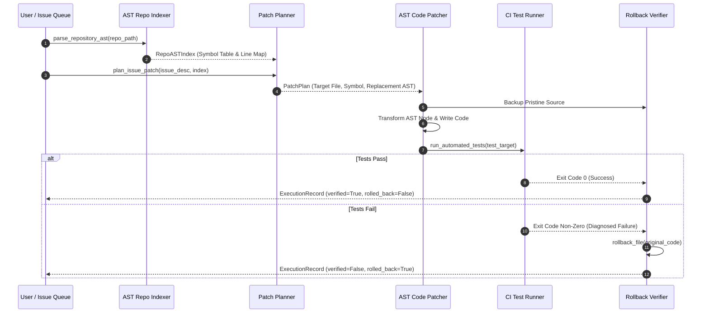

# Autonomous Software Engineering Agent

[](https://www.python.org/)
[](https://docs.pydantic.dev/)
[](test_engine.py)

An autonomous software engineering system featuring an AST repository parser, issue-to-patch planner, AST-level code transformer, automated CI test diagnostician, and zero-loss patch rollback verifier.

---

## Architecture Overview

```
                      ┌────────────────────────────────┐
                      │     Target Codebase / Repo     │
                      │  [Python Source Modules & AST] │
                      └───────────────┬────────────────┘
                                      │
                                      ▼
                      ┌────────────────────────────────┐
                      │      AST Repository Parser     │
                      │ Extracts Functions/Classes/Syms│
                      └───────────────┬────────────────┘
                                      │
                                      ▼
                      ┌────────────────────────────────┐
                      │     Issue-to-Patch Planner     │
                      │ Matches Traceback / Defect Sym │
                      └───────────────┬────────────────┘
                                      │
                                      ▼
                      ┌────────────────────────────────┐
                      │        AST Code Patcher        │
                      │ Replaces Node & Validates Tree │
                      └───────────────┬────────────────┘
                                      │
                                      ▼
                      ┌────────────────────────────────┐
                      │    Automated CI Test Runner    │
                      │   Executes Subprocess Pytest   │
                      └───────┬────────────────┬───────┘
                              │                │
                      [Tests Passed]    [Tests Failed]
                              │                │
                              ▼                ▼
                      ┌───────────────┐┌───────────────┐
                      │ Verify Patch  ││ Rollback File │
                      │ Retain State  ││ Pristine Undo │
                      └───────────────┘└───────────────┘
```

---

## Sequence Flow



---

## Core Components

1. **AST Repository Parser (`parse_repository_ast`, `extract_symbol_source`)**:
   - Recursively traverses repository directories while ignoring VCS and cache artifacts (`.git`, `__pycache__`, `.venv`).
   - Parses Python files into AST syntax trees to index all function definitions, asynchronous functions, classes, and class methods.
   - Preserves source line ranges, docstrings, argument signatures, and symbol-to-file mappings.

2. **Issue-to-Patch Planner (`plan_issue_patch`)**:
   - Analyzes issue descriptions, natural language bug reports, or raw exception tracebacks (`File "...", line X, in Y`).
   - Identifies candidate target files and symbols within the indexed repository.
   - Generates structured, deterministic `PatchPlan` objects with confidence scoring.

3. **AST Code Patcher (`patch_ast_symbol`, `apply_patch_to_file`)**:
   - Operates directly at the abstract syntax tree level rather than fragile string replacements.
   - Replaces target functions, class methods, or classes in-place within the syntax tree.
   - Automatically repairs parent locations via `ast.fix_missing_locations` and verifies resulting code syntax validity before writing to disk.

4. **CI Test Runner & Diagnostician (`run_automated_tests`, `diagnose_test_failure`)**:
   - Executes unit and integration test suites via isolated subprocess invocations.
   - Parses stderr and stdout to diagnose failure categories (`ZeroDivisionError`, `AssertionError`, `TypeError`, `SyntaxError`, etc.).
   - Extracts failure locations (filename and line number) from traceback streams.

5. **Patch Rollback Verifier (`rollback_file`, `verify_and_resolve_patch`)**:
   - Creates in-memory snapshot backups before applying modifications.
   - Evaluates test suite passage. If tests fail, automatically triggers atomic rollback to restore pristine code state.
   - Emits structured `ExecutionRecord` telemetry detailing latency, pass status, and rollback flags.

---

## Pydantic v2 Models

- `CodeSymbol`: Identifies symbol type (`function`, `class`, `method`), line numbers, arguments, and docstrings.
- `RepoASTIndex`: Comprehensive repository symbol registry and lookup map.
- `PatchAction`: Single transformation unit defining target symbol, file path, and replacement code.
- `PatchPlan`: Defect remediation plan with target files and confidence score.
- `TestResult`: Test outcome, exit code, execution stdout/stderr, and diagnosed failure classification.
- `ExecutionRecord`: Lifecycle execution audit including verification status, rollback status, and elapsed duration.

---

## CLI & Benchmark Usage

### Repository AST Indexing
```bash
python projects/autonomous_software_engineering_agent/main.py --repo .
```

### Performance Benchmark
Run high-throughput AST transformation and rollback verification benchmarks:
```bash
python projects/autonomous_software_engineering_agent/main.py --benchmark --iterations 100
```

---

## Test Specifications

Run pytest directly on the test suite:
```bash
pytest projects/autonomous_software_engineering_agent/test_engine.py -v
```

The test suite covers:
- **`test_models_validation`**: Validates Pydantic v2 model schemas and serialization.
- **`test_ast_repository_parser`**: Evaluates parsing of classes, methods, functions, line numbers, and docstring extraction.
- **`test_issue_patch_planner`**: Tests symbol resolution from both natural descriptions and exception tracebacks.
- **`test_ast_code_patcher_function_and_method`**: Verifies AST replacement of both standalone functions and class methods.
- **`test_ast_patcher_edge_cases`**: Tests empty replacement rejection, missing symbol handling, and syntax validation.
- **`test_ci_failure_diagnostician`**: Tests traceback parsing, exception categorization, and line number extraction.
- **`test_patch_rollback_on_test_failure`**: Verifies atomic rollback to pristine code when a patch fails CI.
- **`test_patch_success_and_verification`**: Verifies patch retention and verified status when tests pass.
