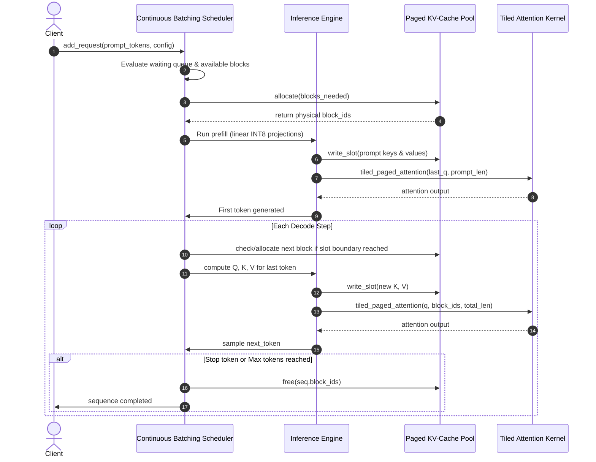

# Custom AI Inference Kernel Engine

A high-performance, modular AI inference kernel engine in Python with:
1. **Optimized Attention Kernels**: Tiled online-softmax attention (FlashAttention/PagedAttention style) directly executing against paged physical memory.
2. **INT8 Dynamic Quantization Emulator**: Symmetric INT8 weight and activation quantization with INT32 accumulation and dynamic dequantization.
3. **Continuous Batching Scheduler**: Iteration-level scheduling separating prompt prefill and token decode with dynamic admission and preemption under memory pressure.
4. **Paged KV-Cache Memory Manager**: Virtual-to-physical block mapping pool preventing virtual memory fragmentation and ensuring 100% block reclamation upon sequence termination.

---

## Architecture Overview

```
                      +---------------------------------------+
                      |           Inference Engine            |
                      +---------------------------------------+
                                          |
                   +----------------------+----------------------+
                   |                                             |
                   v                                             v
       +-----------------------+                     +-----------------------+
       |  Continuous Batching  |                     |  Paged KV-Cache Pool  |
       |       Scheduler       |                     |  [Block 0] [Block 1]  |
       | Waiting | Running | Q |                     |  [Block 2] [Block 3]  |
       +-----------------------+                     +-----------------------+
                   |                                             |
                   v                                             v
       +-----------------------+                     +-----------------------+
       | INT8 Quantized Linear |                     |   Tiled Paged SDPA    |
       |  w_q, w_k, w_v, w_o   |                     |     Online Softmax    |
       +-----------------------+                     +-----------------------+
```

### 1. Paged KV-Cache Memory Manager
- Partitions KV memory into fixed-size physical blocks (`block_size` tokens, default 16).
- Each block holds key and value tensors of shape `(block_size, num_heads, head_dim)`.
- Eliminates internal and external fragmentation by allocating slots block-by-block dynamically as sequences grow.
- Recovers blocks back to the free pool immediately when sequences reach stop tokens or token limits.

### 2. Tiled Online-Softmax Attention Kernel
- Executes decode steps directly over non-contiguous physical blocks without materializing contiguous KV tensors.
- Implements online softmax tracking running maximum $m$ and running denominator $l$:
  $$m_{new} = \max(m, m_{blk}), \quad l_{new} = l \cdot e^{m - m_{new}} + \sum e^{S_{blk} - m_{new}}$$
  $$acc_{new} = acc \cdot e^{m - m_{new}} + P_{blk} \cdot V_{blk}$$
- Guaranteed numerical parity ($< 10^{-5}$ max absolute difference) with standard scaled dot-product attention.

### 3. INT8 Dynamic Quantization Emulator
- Symmetric weight quantization: $W_{q} = \text{clip}\left(\left\lfloor \frac{W}{\text{scale}_w} \right\rceil, -128, 127\right)$.
- Dynamic activation quantization: inputs are scaled on-the-fly per batch.
- Integer GEMM: intermediate integer accumulation in INT32 before scaling back to float32.
- Delivers 4.0x theoretical memory compression with mean absolute error (MAE) typically $< 0.003$.

### 4. Continuous Batching Scheduler
- Iteration-level scheduling: newly admitted sequences execute prompt prefill, while active sequences execute concurrent decode steps.
- Handles variable-length prompts and variable generation lengths.
- Preemption mechanism: when cache blocks are exhausted by high concurrency, lower-priority sequences are preempted, their blocks freed, and re-scheduled once memory frees up.

---

## Sequence Flow



---

## CLI Usage & Benchmark Run

### Run Benchmark
```bash
python projects/custom_inference_kernel_engine/main.py --num-prompts 8 --batch-size 4
```

### Run Side-by-Side INT8 vs FP32 Comparison
```bash
python projects/custom_inference_kernel_engine/main.py --num-prompts 6 --compare
```

### CLI Arguments
- `--num-prompts`: Number of synthetic requests (default: 8).
- `--batch-size`: Max concurrent running sequences in scheduler (default: 4).
- `--block-size`: Tokens per physical block (default: 16).
- `--num-blocks`: Total physical blocks in cache pool (default: 32).
- `--hidden-dim`: Transformer hidden dimension (default: 128).
- `--num-heads`: Attention heads (default: 4).
- `--head-dim`: Head dimension (default: 32).
- `--no-quant`: Disable INT8 quantization and run full-precision FP32.
- `--compare`: Run comparative benchmark between FP32 and INT8.

---

## Test Specifications

The project includes an extensive pytest test suite in [test_engine.py](file:///c:/Users/4/Music/backups/shivanshdimri-main/projects/custom_inference_kernel_engine/test_engine.py):

| Test Case | Description | Target Coverage |
|---|---|---|
| `test_int8_quantization_roundtrip_and_matmul_error` | Symmetric INT8 quantization error bounds, scale factor, and INT32 accumulation GEMM MAE. | INT8 dynamic quantization emulator |
| `test_paged_kv_cache_allocation_and_reclamation` | Block allocation, free list management, pool exhaustion handling, and 100% reclamation. | Paged KV-Cache allocator |
| `test_paged_kv_cache_write_and_slot_integrity` | Writing slots across multiple blocks ensuring zero corruption of untouched slots. | KV cache slot indexing |
| `test_tiled_paged_attention_numerical_parity` | Verifies tiled online-softmax attention matches standard SDPA ($< 10^{-5}$ error). | Tiled paged attention kernel |
| `test_continuous_batching_multi_sequence_execution` | Multi-request continuous batching with varying prompt and generation lengths. | Continuous batching scheduler |
| `test_scheduler_preemption_under_memory_pressure` | Scheduler memory pressure handling: preempting active sequences and re-admitting them. | Scheduler preemption |
| `test_stop_token_early_termination` | Validates immediate termination and resource cleanup upon sampling configured stop tokens. | Stopping criteria & cleanup |
| `test_engine_benchmark_runner` | End-to-end benchmark execution and telemetry collection. | Telemetry & metrics |
| `test_edge_case_single_token_and_exact_block_boundary` | Tests 1-token prompt and prompt lengths that align exactly with `block_size`. | Edge-case boundary conditions |
| `test_int8_quantization_vs_fp32_end_to_end` | Side-by-side execution of identical sequences in both INT8 and FP32 modes. | Numerical stability & quant MAE |

### Run Test Suite
```bash
python -m pytest projects/custom_inference_kernel_engine/test_engine.py -v
```
