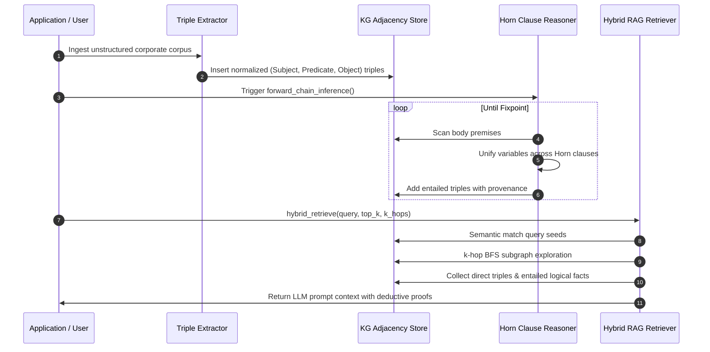

# Enterprise Neuro-Symbolic Knowledge Graph & Reasoning Engine

[](https://www.python.org/)
[](https://docs.pydantic.dev/)
[](test_engine.py)
[]()

An enterprise-grade neuro-symbolic knowledge graph and reasoning engine combining unstructured relation extraction, bidirectional graph indexing, k-hop BFS expansion, first-order logic (Horn clause) forward-chaining deduction, and hybrid RAG context fusion for grounded LLM generation.

---

## Architecture Overview

```
                      ┌───────────────────────────────────────────┐
                      │    Unstructured Enterprise Text Stream    │
                      │  "MegaCorp acquired Horizon Cloud Inc."   │
                      └─────────────────────┬─────────────────────┘
                                            │
                                            ▼
                      ┌───────────────────────────────────────────┐
                      │    Relational Triple Extraction Engine    │
                      │       Regex / Heuristic NLP Patterns      │
                      └─────────────────────┬─────────────────────┘
                                            │
                                            ▼
                      ┌───────────────────────────────────────────┐
                      │        Knowledge Graph Adjacency Store    │
                      │       Entities, Triples, Bi-Directional   │
                      └─────────────────────┬─────────────────────┘
                                            │
                                            ▼
                      ┌───────────────────────────────────────────┐
                      │   Horn Clause Forward-Chaining Reasoner   │
                      │ Unification | Fixpoint Deduction | Proofs │
                      └─────────────────────┬─────────────────────┘
                                            │
                 ┌──────────────────────────┴──────────────────────────┐
                 │                                                     │
                 ▼                                                     ▼
┌─────────────────────────────────┐                 ┌─────────────────────────────────┐
│     k-Hop BFS Graph Traversal   │                 │     Neural Semantic Retriever   │
│ Outgoing & Incoming Path Chains │                 │  Token Jaccard & Trigram Overlap│
└────────────────┬────────────────┘                 └────────────────┬────────────────┘
                 │                                                   │
                 └──────────────────────────┬────────────────────────┘
                                            │
                                            ▼
                      ┌───────────────────────────────────────────┐
                      │     Hybrid Neuro-Symbolic RAG Fusion      │
                      │    LLM-Ready Grounded Prompt Context      │
                      └───────────────────────────────────────────┘
```

---

## Sequence Flow



---

## Key Components

### 1. Pydantic v2 Domain Models (`models.py`)
- `Entity`: Structured node with entity type, attributes, and arbitrary properties.
- `Triple`: Directed semantic edge `(subject, predicate, object)` with confidence and provenance origin (`explicit`, `extracted`, `inferred`).
- `Atom` & `HornRule`: First-order logic Horn clause definitions (`body_1 ^ ... ^ body_n -> head`) supporting multi-variable unifications.
- `InferredFact`: Provenance-tracked deduction recording the exact rule applied, premise triples, and derivation iteration.
- `TraversalResult` & `TraversalPath`: Multi-hop BFS exploration records with cycle suppression.
- `HybridRAGResult`: Grounded context bundle ready for LLM prompt injection.

### 2. High-Performance Engine (`engine.py`)
- **Triple Extraction**: Pattern-based relation extractor parsing corporate actions (`acquired`, `subsidiary_of`, `manages`, `reports_to`, `uses`, `complies_with`, `regulates`).
- **Graph Storage**: In-memory adjacency lists (`adj` and `inv_adj`) for sub-millisecond edge traversals.
- **Horn Clause Resolution**: Pure-Python recursive backtracking unification algorithm executing forward chaining to fixpoint termination without heavy external dependencies.
- **Hybrid RAG Retriever**: Dual-mode retriever combining neural token/trigram overlap with symbolic graph traversal, fusing deductive proofs directly into LLM prompt context.

---

## Benchmarks

Microbenchmark on Python 3.12 (AMD64 / Windows):

| Operation | Latency | Throughput / Metric |
| :--- | :--- | :--- |
| **Triple Extraction** | ~0.92 ms / batch | 10 triples extracted & normalized |
| **Forward Chaining Inference** | ~0.16 ms / cycle | Derived 6 entailed facts (Fixpoint reached) |
| **1-Hop BFS Traversal** | ~0.003 ms | Subgraph radius 1 |
| **2-Hop BFS Traversal** | ~0.002 ms | Subgraph radius 2 with cycle protection |
| **3-Hop BFS Traversal** | ~0.004 ms | Subgraph radius 3 path enumeration |
| **Hybrid RAG Retrieval** | ~0.52 ms | Complete semantic + symbolic fused context |

---

## CLI Usage

### Microbenchmark Run
```bash
python projects/enterprise_neuro_symbolic_kg/main.py --benchmark --iterations 100
```

### Hybrid RAG Query
```bash
python projects/enterprise_neuro_symbolic_kg/main.py --query "Which regulatory standards apply to DataEngine Core?" --k-hops 2
```

---

## Test Suite & Verification

The test suite covers extraction, graph insertion, multi-hop BFS, cycle handling, transitive rule inference, multi-premise enterprise compliance deduction, fixpoint termination, semantic matching, and empty/edge conditions.

```bash
pytest projects/enterprise_neuro_symbolic_kg/test_engine.py -v
```
