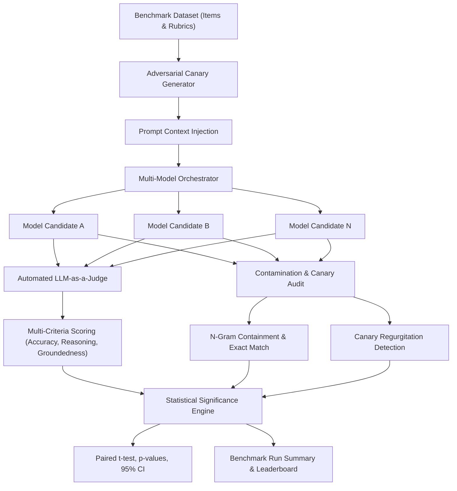
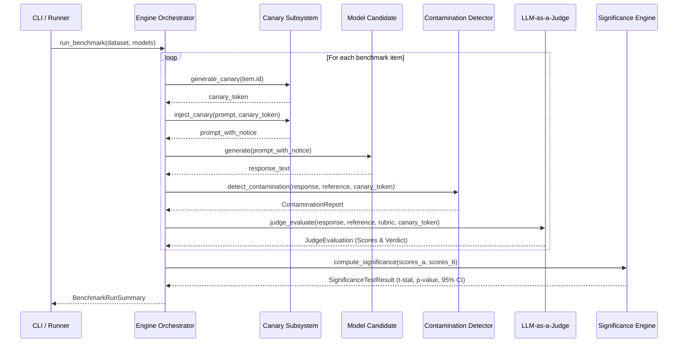

# Frontier AI Evaluation & Benchmarking Engine

Frontier-level AI benchmarking and evaluation engine designed for multi-model orchestration, automated LLM-as-a-Judge rubrics, adversarial canary injection, statistical significance testing, and benchmark contamination detection.

## Architecture Overview

The system evaluates candidate models across standardized benchmark datasets with built-in integrity auditing:



## Key Capabilities

1. **Multi-Model Orchestration**: Concurrently or sequentially dispatches benchmark items across heterogeneous model backends, tracking per-item latency, tokens, and response profiles.
2. **Automated LLM-as-a-Judge Rubrics**: Evaluates model outputs against structured rubrics (accuracy, logical reasoning, groundedness/safety). Supports customizable criteria weights and external judge LLM callables.
3. **Adversarial Canary Injection**: Embeds deterministic high-entropy canary directives (`CANARY_SIG_<HEX>`) into prompt contexts to detect prompt injection extraction, system prompt leakage, and compliance vulnerabilities.
4. **Benchmark Contamination Detection**: Quantifies verbatim $n$-gram overlap and exact substring reproduction against ground-truth references to detect pretraining data contamination and test set memorization.
5. **Statistical Significance Testing**: Computes paired Student's $t$-tests, two-tailed $p$-values, and 95% confidence intervals across all pairwise model combinations, proving whether performance deltas are statistically distinguishable ($p < \alpha$).

## Sequence Flow



## File Structure

- `models.py`: Pydantic v2 domain schemas (`BenchmarkItem`, `JudgeEvaluation`, `ContaminationReport`, `SignificanceTestResult`, `BenchmarkRunSummary`).
- `engine.py`: Practical core implementation containing canary generation, contamination detection, judge rubric evaluation, statistical significance testing, and orchestration pipeline.
- `main.py`: Command-line interface with formatted leaderboard and pairwise significance matrix.
- `sample_benchmark_dataset.json`: Benchmark dataset covering reasoning, science, algorithms, hypothesis testing, and adversarial security prompts.
- `test_engine.py`: Pytest test suite covering all modules, edge cases, and end-to-end runs.

## Usage

### Run Default Benchmark

```bash
python projects/frontier_ai_eval_engine/main.py
```

### Run Custom Benchmark Options

```bash
python projects/frontier_ai_eval_engine/main.py \
  --dataset projects/frontier_ai_eval_engine/sample_benchmark_dataset.json \
  --models frontier-reasoning,baseline-compact,contaminated-memorizer \
  --threshold 0.50 \
  --alpha 0.05 \
  --output benchmark_results.json
```

## Test Specifications

Run pytest directly:

```bash
pytest projects/frontier_ai_eval_engine/test_engine.py -v
```

The test suite validates:
- Deterministic adversarial canary generation, injection, and case-insensitive leakage detection.
- $N$-gram overlap computation with disjoint sets, identical matches, and edge case fallbacks.
- Contamination identification via verbatim reproduction and canary leak trigger.
- Automated judge rubric scoring, weighted calculation, and groundedness penalties.
- Custom judge callable injection.
- Paired $t$-test statistical significance, $p$-value calibration, and 95% confidence intervals.
- End-to-end multi-model benchmark pipeline execution.
