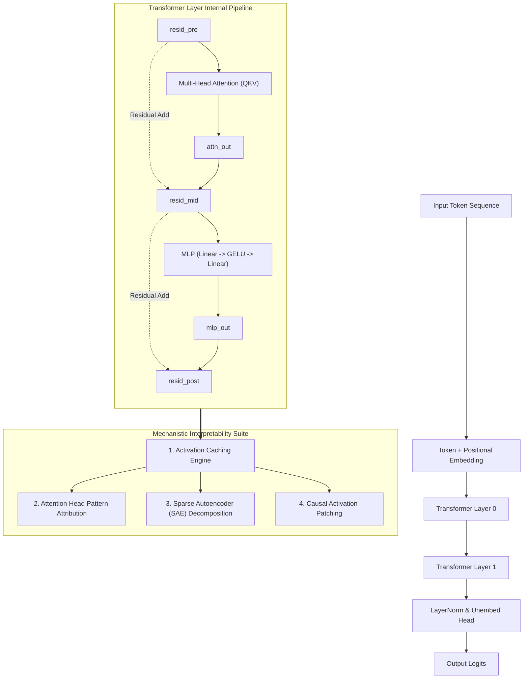
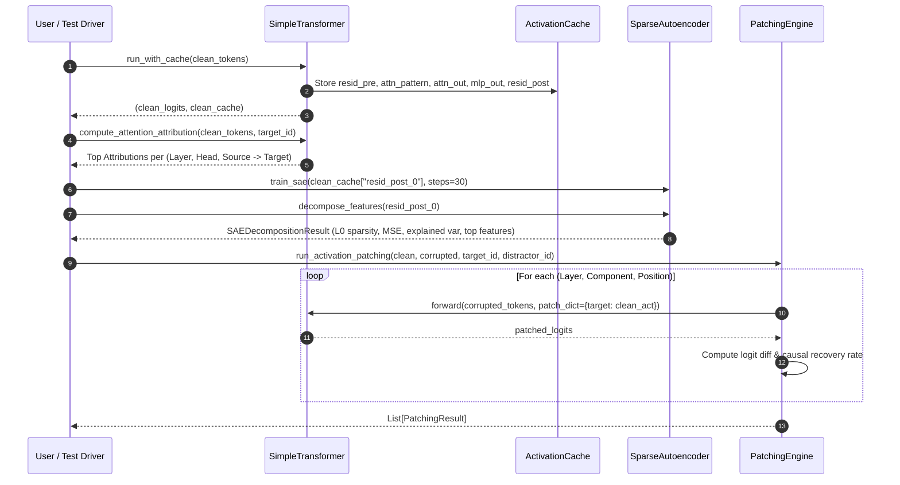

# Mechanistic Interpretability Suite

A lightweight, high-performance mechanistic interpretability toolkit designed for Transformer model internals. It provides residual stream activation caching, attention head pattern attribution, Sparse Autoencoder (SAE) monosemantic feature decomposition, and causal activation patching interventions.

---

## Architecture Overview



### Core Components

1. **Residual Stream Activation Caching (`run_with_cache`)**:
   - Non-intrusively captures intermediate tensors across the computation graph: `resid_pre`, `attn_pattern`, `attn_v`, `attn_out`, `mlp_out`, and `resid_post` for all layers.
   - Computes statistical summaries (`ActivationSummary`) including mean, standard deviation, and L2 norms.

2. **Attention Head Pattern Attribution (`compute_attention_attribution`)**:
   - Inspects multi-head attention weight patterns $\alpha_{h, i, j}$.
   - Computes directional attribution scores by projecting head output vectors $\mathbf{W}_{O, h} \cdot \mathbf{v}_s \cdot \alpha_{h, t, s}$ along the target unembedding direction $\mathbf{W}_{U}[:, y_{\text{target}}]$.

3. **Sparse Autoencoder Feature Decomposition (`SparseAutoencoder`)**:
   - Disentangles polysemantic residual representations into overcomplete, sparse feature spaces using:
     $$f(\mathbf{x}) = \text{ReLU}\left(\mathbf{W}_{\text{enc}}(\mathbf{x} - \mathbf{b}_{\text{dec}}) + \mathbf{b}_{\text{enc}}\right)$$
     $$\hat{\mathbf{x}} = \mathbf{W}_{\text{dec}} f(\mathbf{x}) + \mathbf{b}_{\text{dec}}$$
   - Enforces $L_1$ sparsity and unit-norm column constraints on decoder dictionary features.
   - Evaluates $L_0$ sparsity, reconstruction MSE, and explained variance percentage.

4. **Causal Activation Patching Interventions (`run_activation_patching`)**:
   - Performs counterfactual interventions between a clean input and a corrupted input.
   - Injects clean activations at specific layers, components (`resid_pre`, `attn_out`, `mlp_out`, `resid_post`), and token positions during the corrupted forward pass.
   - Computes the logit difference recovery metric:
     $$\text{Recovery Rate} = \frac{\Delta_{\text{patched}} - \Delta_{\text{corrupted}}}{\Delta_{\text{clean}} - \Delta_{\text{corrupted}}}$$

---

## Sequence Flow



---

## File Structure

- `models.py`: Pydantic v2 schemas for `TransformerConfig`, `ActivationSummary`, `AttentionAttribution`, `SAEConfig`, `SAEDecompositionResult`, `PatchingResult`, and `SuiteReport`.
- `engine.py`: Transformer architecture, forward caching, attention attribution, SAE training/decomposition, and activation patching.
- `main.py`: Command-line driver and benchmarking runner.
- `test_engine.py`: Pytest suite with 8 test cases covering unit assertions and edge cases.

---

## CLI Usage & Benchmark

### Run Suite Inspection
```bash
python -m projects.mechanistic_interpretability_suite.main
```

### Run Benchmark
```bash
python -m projects.mechanistic_interpretability_suite.main --benchmark --iterations 30
```

### JSON Export
```bash
python -m projects.mechanistic_interpretability_suite.main --json
```

---

## Test Specifications

Run tests with pytest:
```bash
pytest projects/mechanistic_interpretability_suite/test_engine.py -v
```

### Test Coverage Highlights
1. `test_forward_pass_and_residual_stream_caching`: Validates output shapes, cache keys across all layers, and verifies strict upper-triangular causal attention masking.
2. `test_cache_summarization`: Ensures non-negative standard deviations and L2 norms on all activation summaries.
3. `test_attention_head_pattern_attribution`: Checks sorted order of head attributions and validity of bounds with and without target unembedding projection.
4. `test_sparse_autoencoder_training_and_decomposition`: Verifies loss decrease during training, unit-norm decoder constraints, bounded explained variance, and $L_0$ feature sparsity metrics.
5. `test_causal_activation_patching`: Tests counterfactual patching and verifies exact 1.0 recovery when patching corrupted token position with clean residual stream activation.
6. `test_edge_cases_single_token_and_minimal_transformer`: Verifies operation with sequence length 1 and minimal 1-layer 1-head configuration.
7. `test_pydantic_schema_validations`: Validates bounds and raises `ValidationError` on illegal hyperparameter inputs.
8. `test_suite_end_to_end_report`: Tests the end-to-end suite runner and validates `SuiteReport` serialization.
