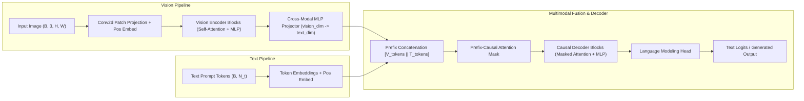
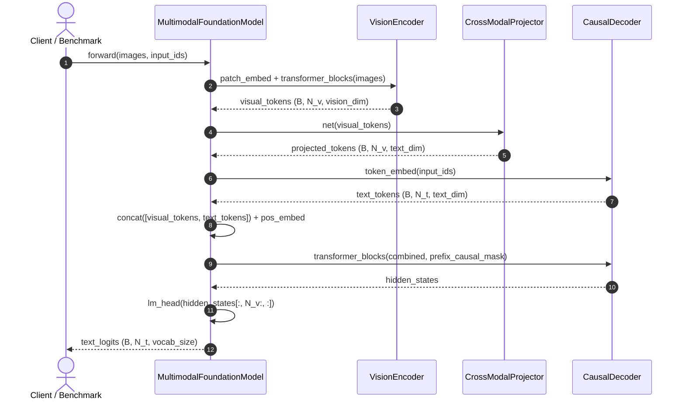

# Multimodal Foundation Model

A lightweight, high-performance Vision-Language Foundation Model implemented from scratch in pure PyTorch and Pydantic v2.

The architecture integrates a Vision Transformer (ViT) patch projection, a 2-layer cross-modal MLP projection layer, and a causal decoder language model operating with prefix attention fusion for visual reasoning and autoregressive text generation.

---

## Architecture Overview



### Components

1. **ViT Patch Projection (`PatchEmbedding` & `VisionEncoder`)**:
   - Converts raw 3-channel input images `(B, 3, H, W)` into 2D patch representations using 2D convolution with kernel size and stride equal to `patch_size`.
   - Flattens patches and injects learnable spatial position embeddings: `(B, N_patches, vision_dim)`.
   - Processes patches through pre-LayerNorm multi-head self-attention Transformer blocks.

2. **Cross-Modal MLP Projection Layer (`CrossModalProjector`)**:
   - Projects visual feature tokens from visual hidden dimension (`vision_dim`) into the language decoder dimension (`text_dim`).
   - Implemented as a two-stage feedforward network with GELU activation: `Linear(vision_dim, mlp_dim) -> GELU -> Linear(mlp_dim, text_dim)`.

3. **Causal Decoder Language Model (`CausalDecoder`)**:
   - Embeds input text tokens and adds sequence positional embeddings.
   - Concatenates projected visual tokens as a prefix before text tokens: `[V_1, ..., V_k, T_1, ..., T_m]`.
   - Uses a **Prefix-Causal Attention Mask**:
     - Visual prefix tokens attend bidirectionally to each other.
     - Text tokens attend to all visual prefix tokens and autoregressively to preceding text tokens. Future text positions are strictly masked with $-\infty$.

4. **Visual Reasoning Evaluation**:
   - Evaluates multi-modal reasoning capability across visual perception and reasoning tasks (e.g. color identification, spatial counts).
   - Computes candidate option log-likelihoods conditioned on visual features and question prompts:
     $$\mathcal{L}(\text{option} \mid \text{image}, \text{question}) = \frac{1}{|\text{option}|} \sum_{t=1}^{|\text{option}|} \log P(y_t \mid \text{image}, \mathbf{x}, y_{<t})$$
   - Computes per-sample accuracy, latency (ms), and frame throughput (FPS).

---

## Sequence Flow



---

## File Structure

- `models.py`: Pydantic v2 schemas (`ModelConfig`, `VisualReasoningSample`, `InferenceOutput`, `EvaluationResult`, `BenchmarkReport`).
- `engine.py`: Core PyTorch modules (`PatchEmbedding`, `VisionEncoder`, `CrossModalProjector`, `CausalDecoder`, `MultimodalFoundationModel`), `SimpleTokenizer`, synthetic dataset generator, and training step.
- `main.py`: Command-line driver and benchmark runner.
- `test_engine.py`: Pytest suite with 10 test functions covering shape verification, causality, generation, visual reasoning evaluation, weight updates, and edge cases.
- `README.md`: Architecture overview, sequence flow, and test specs.

---

## Test Specifications

| Test Name | Target Component | Verifications & Invariants |
| :--- | :--- | :--- |
| `test_tokenizer_encode_decode` | `SimpleTokenizer` | BOS/EOS injection, round-trip fidelity, unk token fallback |
| `test_patch_embedding_shape` | `PatchEmbedding` | Spatial-to-patch projection dimensions `(B, (H/P)^2, D)` |
| `test_cross_modal_projector` | `CrossModalProjector` | Linear-GELU projection mapping `vision_dim` to `text_dim` |
| `test_multimodal_forward_and_loss`| `MultimodalFoundationModel` | Forward pass logits shape, CrossEntropyLoss computation, end-to-end gradient flow |
| `test_prefix_causal_mask` | `_build_prefix_causal_mask` | Bidirectional visual block, strictly causal text attention |
| `test_model_generation` | `generate` | Autoregressive sampling, EOS cutoff, latency measurement |
| `test_visual_reasoning_evaluation`| `evaluate_reasoning` | Multiple-choice scoring, accuracy bounds `[0, 1]`, latency tracking |
| `test_train_step_reduces_or_updates_weights` | `train_step` | Backpropagation modifies projection parameters |
| `test_edge_cases` | Edge conditions | Single-item batch (`B=1`), open-ended generation fallback, sequence length limit `ValueError` |
| `test_config_validation` | `ModelConfig` | Pydantic v2 validation bounds on dropout and patch sizes |

---

## Quickstart & CLI Usage

### Run Tests
```powershell
pytest projects/multimodal_foundation_model/test_engine.py -v
```

### Run Benchmark Driver
```powershell
# Run benchmark on synthetic visual reasoning dataset
python projects/multimodal_foundation_model/main.py --samples 16 --epochs 5

# Export benchmark report to JSON
python projects/multimodal_foundation_model/main.py --samples 8 --epochs 3 --output projects/multimodal_foundation_model/benchmark_results.json
```
